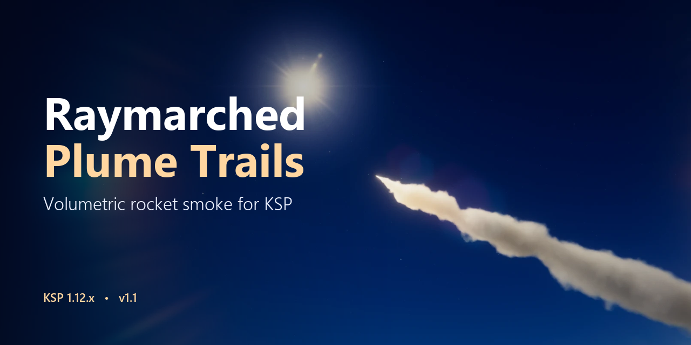

# Raymarched Plume Trails mod for KSP!

Volumetric exhaust plume smoke for rockets, uses Henyey-Greenstein phase scattering for realistic shadowed look, it's fully raymarched too
# Features
 - It's raymarched (not particles!): every trail is a chain of capsules marched by the GPU, lit by the sun and the sky with Henyey-Greenstein phase scattering and multiple scattering (soft bright core, darker edge)
 - **Every solid booster leaves its own trail** from its own nozzle; they widen and merge into one column like the real thing. By default only solid boosters smoke (switch it off in the window to give every engine a trail)
 - The smoke starts where the engine flame ends and grows out of it; it widens, drifts and thins out with altitude (the trail ends at 25 km by default, adjustable)
 - Lit by the colour of the sun and the sky (Scatterer) and by the clouds of EVE; casts a shadow on the ground
 - Cleared on Revert Flight and when you leave to the space centre; a burnt-out booster that is staged away stops smoking
 - Waterfall and Avalanche Plumes integration: the smoke continues from the end of the Waterfall flame, motors that Avalanche gives a SolidSmoke effect count as solid, and Avalanche's own particle smoke is hidden under the trail
 - Optional physical plumes (shock diamonds, afterburning) that take their size, expansion and colours from the Waterfall flame of the engine (off by default, experimental)
 - Heat haze over the nozzle and a scene light of the flame that follows Waterfall's own flame light
 - In game config editor (Simple and Advanced view)
 - Quality selector with auto adjusting to the frame rate, optional temporal upscaling on lower quality presets
 - Right now it works best with Avalanche plumes (peak plume mod btw)
# Windows only (linux and mac shaders coming soon)
# Installation
Download the zip and extract it. Open your KSP install folder. Copy the GameData folder from the extracted zip into your KSP GameData folder, so you end up with GameData/RaymarchedPlumeTrails inside your existing GameData. If you already have an older VolumetricContrails folder from a previous version, delete that one first, don't just drop the new one next to it.

Nothing is required except KSP 1.12.x. Recommended but optional: Waterfall and Avalanche for the flame/ignition effects, SmokeScreen since Avalanche depends on it, Scatterer and EVE for the sky and cloud lighting, ModuleManager (get it from CKAN or SpaceDock, not bundled) for the mods above. Windows only for now. Launch KSP, the smoke trail settings are in the in-game mod UI, toolbar icon should show up in flight.

# Reporting a bug
Please attach your `KSP.log` (zip it) to the bug on Discord. The mod writes a line `[PlumeTrails] emit:` and `[PlumeTrails] trail:` every few seconds while an engine fires, they say what the mod did. A screenshot with the mod window open helps too.

# Discord Server
https://discord.gg/mrWnhRyV3u

ai assisted, learning c# on it and i made it for fun!

Images, Click here to expand

KSA inspired me to make this mod
# Credits

Credits to Kyle Kerman (discord:chez_tasty_26158) for making a veeeeeery peak icon for this mod

# Licence

Shield: [![CC BY-NC-SA 4.0][cc-by-nc-sa-shield]][cc-by-nc-sa]

This work is licensed under a
[Creative Commons Attribution-NonCommercial-ShareAlike 4.0 International License][cc-by-nc-sa].

[![CC BY-NC-SA 4.0][cc-by-nc-sa-image]][cc-by-nc-sa]

[cc-by-nc-sa]: http://creativecommons.org/licenses/by-nc-sa/4.0/
[cc-by-nc-sa-image]: https://licensebuttons.net/l/by-nc-sa/4.0/88x31.png
[cc-by-nc-sa-shield]: https://img.shields.io/badge/License-CC%20BY--NC--SA%204.0-lightgrey.svg
